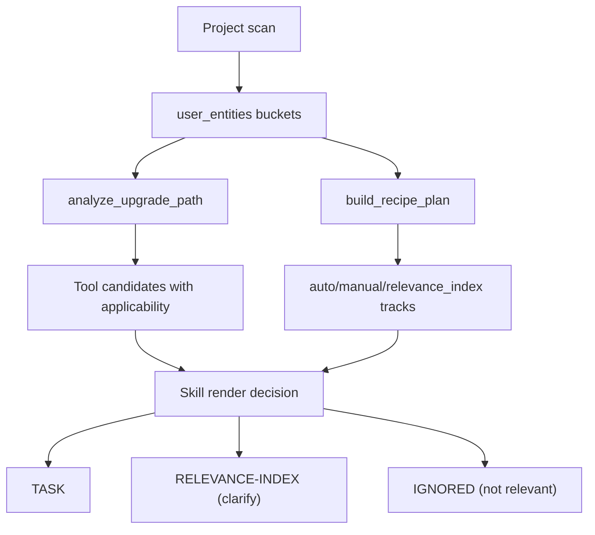

# Tool Rule Selection

This document explains how the Migration Oracle MCP tools read graph knowledge, select
candidate migration rules, and return those candidates to an agent. It also defines the
boundary between MCP tool recall and skill-level project filtering.

## Core Contract

The MCP server is recall-oriented. It should return graph candidates with provenance,
applicability, matched entities, and diagnostics. It should not try to fully decide whether
every candidate is a project task.

The migration skill is precision-oriented. It scans the current project, calls MCP tools,
then renders each returned candidate as one of:

| Render decision | Meaning |
|---|---|
| `TASK` | Exact project evidence proves the rule applies and the instruction is actionable. |
| `TASK (NEEDS-DESIGN-REVIEW)` | Project evidence exists, but the instruction needs human design judgment. |
| `RELEVANCE-INDEX (clarify)` | Candidate may apply, but evidence is insufficient or ambiguous. |
| `IGNORED (not relevant to current project)` | Tool returned the graph rule, but the skill found no matching project residue. |

This keeps graph recall high without flattening every graph hit into migration work.

## Entity Normalization

Most rule-selecting tools accept `user_entities`, a flat list produced by the framework
scanner. `migration_oracle/mcp/tools/upgrade.py::normalize_entities()` splits that list
into typed buckets:

| Bucket | Examples | Matched against |
|---|---|---|
| `scanned_classes` | `org.springframework.http.HttpHeaders` | `Class.name` |
| `scanned_class_simple` | `SpringBootApplication`, `Bean` | simple class/annotation names |
| `scanned_deps_ga` | `org.springframework.boot:spring-boot-starter-data-redis` | dependency `group:artifact` |
| `scanned_dep_artifacts` | `spring-boot-starter-data-redis` | dependency artifact ID |
| `scanned_props` | `spring.jackson.time-zone`, `mainClassName` | `ApplicationProperty.name` and config/build keys |

Matching intentionally avoids broad dependency-to-class inference. A rule for
`spring-boot-starter-aop` should not match merely because the project imports some generic
Spring Boot class.

## Version Resolution

Before querying rules, tools resolve the requested version range against `Version` nodes:

| Call site | Source version | Target version |
|---|---|---|
| `analyze_upgrade_path` | `resolve_version(..., mode="floor")` | `resolve_version(..., mode="ceil")` |
| `build_recipe_plan` | `floor` | `ceil` |
| `check_version_availability` | caller-controlled `floor` or `ceil` | n/a |

`floor` means highest graph version less than or equal to the requested version.
`ceil` means lowest graph version greater than or equal to the requested version. If a
target is ahead of the graph catalogue, `ceil` falls back to the highest known version and
marks `aheadOfCatalogue=true`.

## Rule Applicability

The main graph queries select rules in the version interval:

```cypher
MATCH (v:Version {framework: $framework})
WHERE v.sortableVersion > $current_version_sortable
  AND v.sortableVersion <= $target_version_sortable
MATCH (v)-[:INCLUDES_RULE]->(rule:MigrationRule)
```

Rules are then classified by affected entity coverage:

| Condition | Tool applicability |
|---|---|
| Rule has no `AFFECTS_*` entities | `informational` |
| Caller did not pass `user_entities` | `universal` |
| At least one affected entity matches a scanned bucket | `matched` |
| No match, but rule severity is high or critical | `uncertain` safety-net |
| No match and not severe | `excluded` |

`excluded` rules are not returned by `build_recipe_plan`. `analyze_upgrade_path` counts
them in diagnostics and excludes them from its returned rule list when an entity filter is
active.

## Tool Details

### `analyze_upgrade_path`

Purpose: return migration rules and lifecycle alerts for a framework version range.

Selection flow:

1. Normalize `user_entities` into typed buckets.
2. Resolve source and target versions.
3. Query all `MigrationRule` nodes attached to `Version` nodes in the interval.
4. Apply optional filters:
   - `classification`: `actionable`, `incomplete`, `informational`
   - `scope_filter`: `api-surface`, `runtime`, `config`, `build`, `test`
   - `min_severity`: `low`, `medium`, `high`, `critical`
5. Compute `applicability` from affected entity matches.
6. Attach `MigrationStep` records and linked `OpenRewriteRecipe` metadata when requested.
7. Sort returned rules by applicability and severity.
8. Cap results with `top_n`.
9. Add `matched_entities` using `compute_matched_entities()`.

Return shape:

- `rules`: graph candidate rules with `statement`, `steps`, `scopes`, `recipes`,
  `applicability`, `affected_entities`, and `matched_entities`
- `lifecycle_alerts`: version lifecycle records
- `diagnostics`: counts for scanned entities, included rules, excluded rules, safety-net
  rules, and cap status

Important: this tool returns knowledge candidates. The skill still decides whether each
candidate becomes a task, clarify entry, or ignored entry.

### `build_recipe_plan`

Purpose: turn graph rules into tool-level execution tracks.

Selection flow:

1. Normalize `user_entities`.
2. Resolve source and target versions.
3. Query rules and steps in the version interval.
4. Drop `excluded` rules.
5. For each returned step:
   - if `applicability != "matched"` or no `matched_entities`, put it in
     `relevance_index`
   - if `automatable=true`, `effort="mechanical"`, linked recipe exists, `auto=true`,
     and required params are satisfied, put it in `auto_track`
   - otherwise put it in `manual_track`
6. If graph data has rules but no `MigrationStep` nodes, emit rule-level fallback cards.

Return shape:

- `auto_track`: recipe-backed, mechanical steps
- `manual_track`: matched non-automatic steps
- `relevance_index`: graph candidates returned for skill-level review
- `fallback_to_rule_cards`: true when step nodes were absent
- `diagnostics`: recipe counts and entity-filter counts

Important: `relevance_index` is not rejection. It means the tool returned the graph
candidate but did not classify it as directly executable. The skill may promote it to a
task if exact project residue exists, or mark it ignored if not relevant.

### `check_version_availability`

Purpose: answer whether a framework version is represented in the graph and, for Maven
framework artifacts, whether that version exists on Maven Central.

Selection flow:

1. Canonicalize framework aliases, currently including `springboot -> Spring Boot`.
2. Resolve version with `floor` or `ceil`.
3. Probe Maven Central for exact resolved version and latest patch.
4. Cache Maven results for 24 hours.

This tool does not select rules. It supports planning by making version binding explicit.

### `resolve_deprecation`

Purpose: return one-hop deprecation metadata for one graph entity.

Selection flow:

1. Look up the exact graph entity name. Partial/simple names return `not_found`.
2. Return deprecation version, removal version, direct replacement, and related rules.

Use this after scanning finds a specific FQCN/property/dependency and the agent needs a
precise deprecation chain for that entity.

### `entity_evolution`

Purpose: trace an entity replacement chain.

Selection flow:

1. Start from an exact graph entity name.
2. Follow `REPLACED_BY` edges up to five hops.
3. Return each entity and related rules.

This complements `resolve_deprecation` when the one-hop replacement is incomplete or when
several framework versions are involved.

### `search_migration_knowledge`

Purpose: retrieve relevant migration knowledge by natural language.

Selection flow:

1. Encode the query with the configured sentence-transformer model.
2. Run BM25 search over the `migration_text` index.
3. Run vector search over the `migration_knowledge_vector_mr` index.
4. Fuse both ranked lists with Reciprocal Rank Fusion.
5. Hydrate graph nodes for the fused IDs.

Return shape:

- `hits`: statements/solutions/source URLs/action steps with RRF scores

This tool does not use project entity matching. It is a discovery/escalation tool for
misses or follow-up questions.

### `search_openrewrite_recipes`

Purpose: retrieve candidate OpenRewrite recipes by natural language.

Selection flow:

1. BM25 over `openrewrite_recipe_description`.
2. Vector search over `openrewrite_recipe_vector`.
3. RRF fuse results.
4. Hydrate `OpenRewriteRecipe` nodes.
5. Optionally filter:
   - `only_composite`
   - `require_no_params`

This tool proposes automation candidates. The skill still verifies whether the recipe maps
to a project task.

### `get_community_insights`

Purpose: read community-submitted migration findings.

Selection flow:

1. Convert optional version bounds to sortable versions.
2. Query `MigrationRule` nodes with `ruleType="community_insight"`.
3. Optionally filter by entity name and `verified_only`.

Return shape:

- `insights`: statement, solution, source URL, confidence, votes, verified flag, version

Community insights are knowledge candidates. The skill must still apply exact project
residue checks before converting them into tasks.

### `submit_migration_insight`

Purpose: write a new community insight to the graph.

Selection flow:

1. Resolve the target framework version with `floor`.
2. Generate an embedding if the embedding model is available.
3. Run duplicate detection:
   - exact match
   - vector similarity
   - BM25 plus cosine similarity
4. If duplicate threshold is hit, return `status="duplicate"`.
5. Otherwise create a community `MigrationRule`.

This is a graph write. It captures deviations or findings discovered during real
migrations so recurring manual tasks can become graph-native later.

### `vote_insight` and `verify_insight`

Purpose: maintain community insight quality.

- `vote_insight` increments or decrements a vote count. It is not idempotent.
- `verify_insight` marks an insight as moderator-verified. It is not reversible through
  this tool.

These tools do not select migration rules for a project.

### `resolve_paysafe_dependency_by_service_name`

Purpose: resolve internal `com.paysafe.*` dependency upgrade candidates.

Selection flow:

1. Accept a FindIt service/artifact name.
2. Resolve the repository via FindIt.
3. Inspect GitLab tags, bounded by `max_tags` and resolver timeout.
4. Prefer compatibility metadata when available.
5. If metadata is absent and `allow_latest_overall=true`, select the latest available tag.

Return shape depends on resolver status, but planning consumes:

- `status`
- `selected_version`
- compatibility metadata when present
- error/substatus details when resolution fails

This tool is independent of graph rule matching. The plan skill renders dependency tasks
for every scanned Paysafe dependency when the selected version differs, compatibility is
unverified, or resolution fails.

### `list_pipeline_runs`

Purpose: list framework/version pipeline artifacts stored on `Version` nodes.

Selection flow:

1. Find `Version` nodes with artifact path properties.
2. Return framework, from-version, to-version, and stored artifact paths.

This tool helps agents discover raw extraction/filtering artifacts behind graph data. It
does not select project tasks.

### `get_artifact_content`

Purpose: read a stored pipeline artifact.

Selection flow:

1. Resolve artifact path from the graph `Version` node.
2. Allow only known artifact types:
   - `raw_md`
   - `filtered_md`
   - `entities_json`
3. Read and return file contents.

Callers cannot pass arbitrary filesystem paths. The graph controls path resolution.

### `get_graph_schema`

Purpose: return the authoritative graph schema markdown and server build metadata.

No Cypher is executed. Use this before custom Cypher or when explaining labels,
relationships, and properties.

### `execute_custom_cypher`

Purpose: run read-only diagnostic Cypher.

Selection flow:

1. Check query text for blocked mutation/admin keywords:
   `CREATE`, `MERGE`, `SET`, `DELETE`, `REMOVE`, `DROP`, `CALL db`.
2. If blocked, return `status="blocked"`.
3. Otherwise execute and return rows.

This tool is for inspection only. It should not be used to mutate migration state.

### `install_migration_skill`

Purpose: install the local migration skill bundles into Cursor or Claude Code skill
directories.

Selection flow:

1. Resolve install target:
   - `auto` and `cursor` install Cursor-format skills
   - `claude-code` installs Claude Code-format skills
2. Resolve scope:
   - `project`: `.cursor/skills` or `.claude/skills` under project root
   - `global`: user-level skills directory
3. Pick bundles for active `MIGRATION_MODE`:
   - `full`: research, plan, gap-check, clarify, preview, execute
   - `lite`: migration-lite and openrewrite-runner
4. Copy files through a staging directory, then into the target.

This tool does not query rules. It installs the instructions that decide how returned
rules become files and tasks.

## Skill-Level Rendering

The plan skill consumes tool output and current project scan results. Its current
rendering policy is:

1. Render a `TASK` only when there is concrete project residue:
   - exact dependency coordinate or artifact
   - exact property/config key
   - exact deprecated class/method/import/annotation
   - exact build DSL key such as `mainClassName`
2. Promote `relevance_index` or `uncertain` candidates only when exact residue proves the
   rule applies.
3. Mark graph candidates as `IGNORED (not relevant to current project)` when:
   - the rule is informational/new-feature guidance
   - no scanned entity matches
   - a method-level legacy residue check fails
   - a broad framework symbol is the only match for a specific dependency/module rule
4. Leave `RELEVANCE-INDEX (clarify)` only for genuinely ambiguous project-specific
   candidates.

Example from the OTP experiment:

| Tool candidate | Skill decision | Reason |
|---|---|---|
| `@HttpExchange` auto-configuration | ignored | no client interface/property residue |
| API versioning | ignored | no `spring.web.version.*` or versioned mapping residue |
| JUnit 4 migration | ignored | no JUnit 4 imports/annotations |
| `HttpHeaders.addIfAbsent` | ignored | exact `addIfAbsent(` residue absent |
| Redis serializer rename | task | exact `GenericJackson2JsonRedisSerializer` residue present |
| Jackson 3 import/package migration | task | non-annotation Jackson 2 import/build residue present |
| Gradle `mainClassName` | task | exact Gradle DSL key present |

## End-to-End Flow



## Design Rule

When in doubt, keep recall in the tool and precision in the skill:

- Tool: return candidate, matched entities, applicability, severity, source, and
  diagnostics.
- Skill: inspect current project evidence and decide task, clarify, or ignored.

